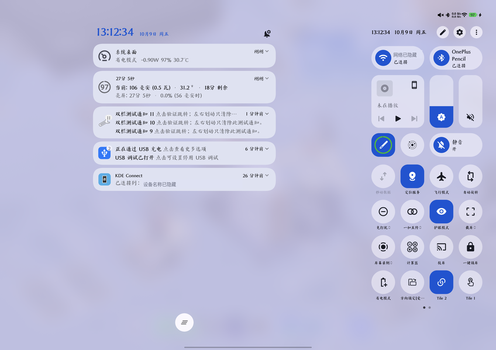

# OneShade

**通知在左，控制中心在右。**

OneShade 是适用于 OPD2413 的 LSPosed 模块，让 ColorOS 在横屏时同时显示通知和控制中心，保留系统原生交互与动画。

## 功能

- 从顶部任一侧下拉，同时展开两栏。
- 通知在左侧居中，支持点击、划除、展开和滚动。
- 保留原生控制中心按钮、滑块及两栏动画，精简重复状态图标。
- 点击或上滑两侧空白处关闭；竖屏和锁屏保持原生界面。

## 使用要求

- OPD2413，Android 16 及以上，ColorOS 通知与控制中心分离模式。
- 已 Root，并安装支持 **Xposed API 102** 的 LSPosed。

已在 ColorOS 16.1 上测试；不锁定具体固件版本，但新固件仍可能需要适配。其他型号暂不支持。

## 下载与安装

1. 从[官方分发仓库](https://github.com/Xposed-Modules-Repo/io.github.ffdvdgd.oneshade/releases/latest)或[源码仓库](https://github.com/FFDVDGD/OneShade/releases/latest)下载并安装 APK。
2. 在 LSPosed 启用“平板双栏控制中心”，确认作用域中的“系统界面”已启用。
3. 保存当前操作后重启系统界面，或重启设备。
4. 开启系统的通知／控制中心分离模式，横屏后从顶部下拉。

模块没有桌面图标，不需要额外授予通知读取或悬浮窗权限。

**从 0.4.1 或更早版本升级：** 0.5.0 已更改包名，请先停用并卸载旧模块 `io.github.opd2413.ctrlcenter`，再安装新包；不能覆盖升级。

## 注意事项

- 极快速收起后立即下拉，可能无法展开；两栏原生动画的结束时刻可能不同。
- 修改系统界面存在兼容风险。安装前保留已授权 USB ADB 和可用的 Root 恢复方式。
- 出现异常时，先在 LSPosed 停用模块并重启系统界面；无法操作时参见[故障排查与恢复](docs/TESTING.md#故障排查与恢复)。

## 反馈与文档

通过 [Issues](https://github.com/FFDVDGD/OneShade/issues) 反馈问题，请附设备型号、系统／框架／模块版本和复现步骤；日志与截图请先脱敏。

- [更新记录](CHANGELOG.md)
- [开发文档](docs/DEVELOPMENT.md)
- [测试与故障排查](docs/TESTING.md)
- [签名与发布维护](docs/LSPOSED.md)

## 许可

[MIT License](LICENSE)。第三方组件保留各自许可，详见[开发文档](docs/DEVELOPMENT.md#来源与许可)。
